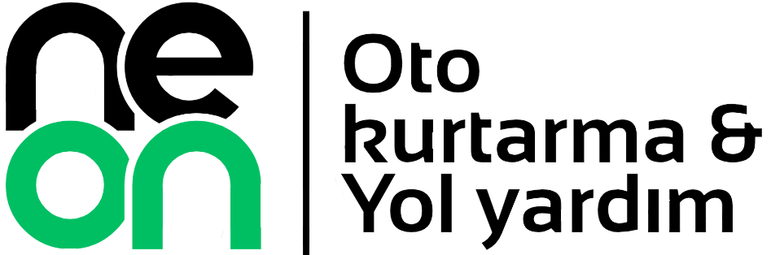
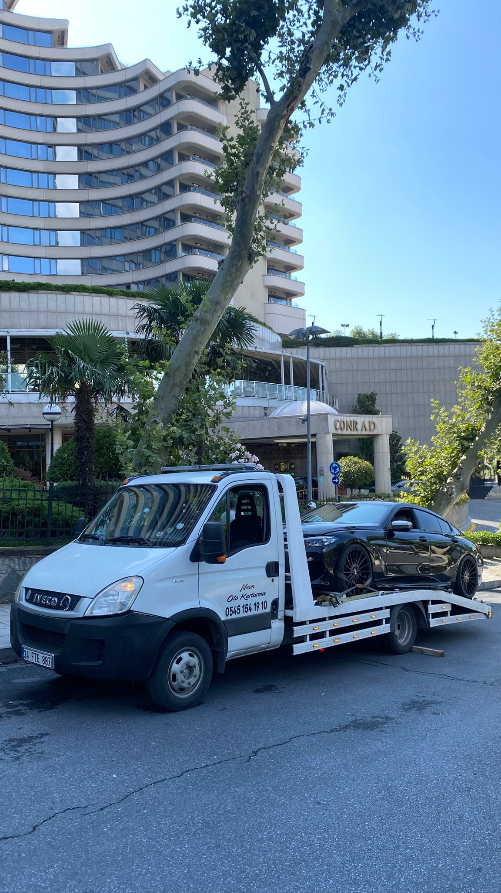
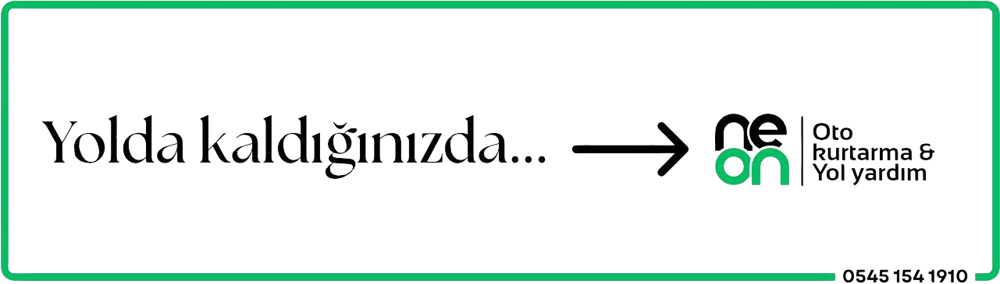

# NEON Oto Kurtarma — Web Platform

<p align="center">
  
</p>

<p align="center">
  İstanbul genelinde 7/24 profesyonel oto çekici, araç kurtarma ve yol yardım hizmetleri sunan <b>NEON Oto Kurtarma</b> için özel olarak tasarlanmış ve geliştirilmiş yüksek performanslı web platformu.
</p>

<p align="center">
  <a href="https://neonotokurtarma.com" target="_blank"><strong>Canlı Siteyi Ziyaret Et &rarr;</strong></a>
</p>

---

## ⚡ Google PageSpeed Insights & Web Vitals Skoru

Mobil cihazlar üzerinde yapılan Lighthouse / PageSpeed test sonuçları:

| Metrik | Puan | Durum |
| :--- | :---: | :--- |
| **Performans** | **98** | 🟢 Mükemmel |
| **Erişilebilirlik (Accessibility)** | **96** | 🟢 Mükemmel |
| **En İyi Uygulamalar (Best Practices)** | **100** | 🟢 Kusursuz |
| **SEO (Search Engine Optimization)** | **100** | 🟢 Kusursuz |

### Temel Web Metrikleri (Core Web Vitals - Mobil)
- **First Contentful Paint (FCP):** `0.9 sn`
- **Speed Index:** `1.1 sn`
- **Largest Contentful Paint (LCP):** `2.4 sn`
- **Cumulative Layout Shift (CLS):** `0` *(Sıfır düzen kayması)*
- **Total Blocking Time (TBT):** `40 ms`

---

## 🛠 Kullanılan Teknolojiler ve Mimari

Bu proje, maksimum hız, sıfır gereksiz yük ve arama motorlarında yerel otorite kazanmak üzere modern web standartlarıyla inşa edilmiştir:

- **Framework:** [Next.js 16](https://nextjs.org/) (App Router & Turbopack Engine)
- **Dil:** [TypeScript](https://www.typescriptlang.org/) (Katı tip denetimi ve güvenli mimari)
- **Stil & Tasarım:** [Tailwind CSS v4](https://tailwindcss.com/)
- **Görsel & Medya Optimizasyonu:** Next.js Image Optimization Pipeline (`AVIF` ve `WebP` adaptif formatları)
- **Tipografi:** Google Fonts (`Inter` & `Playfair Display`) ile `font-display: swap` optimizasyonu
- **Arama Motoru Optimizasyonu (SEO):** 
  - Dinamik XML Site Haritası (`/sitemap.xml`)
  - Dinamik Robot Yönergeleri (`/robots.txt`)
  - Schema.org / JSON-LD Yapılandırılmış Veri (`AutomotiveBusiness` şeması)
  - OpenGraph & Twitter Card kartları
- **Güvenlik & Başlıklar:** Strict HSTS, CSP hazırlığı, X-Frame-Options, modern güvenlik HTTP başlıkları
- **Hosting & Dağıtım:** [Vercel](https://vercel.com) Edge Network (Global CDN)

---

## 📸 Görsel Vitrin

<p align="center">
  
</p>

<p align="center">
  
</p>

---

## ⚖️ Telif Hakkı ve Lisans

Bu proje açık kaynaklı **değildir**. Tüm hakları saklıdır.

```text
Copyright (c) 2026 whyasaf | Ömer Asaf Ak & NEON Oto Kurtarma.
All Rights Reserved.
```

Bu yazılımın kaynak kodları, UI/UX bileşenleri, görselleri ve mimarisi özel mülkiyete tabidir. Yazılı izin alınmaksızın kopyalanması, kısmen dahi olsa çoğaltılması veya ticari/bireysel amaçla kullanılması yasaktır. Ayrıntılar için [LICENSE](LICENSE) dosyasına göz atın.

<p align="center">
  Tasarım ve Geliştirme: <a href="https://whyasaf.com" target="_blank"><b>whyasaf | Ömer Asaf Ak</b></a>
</p>
